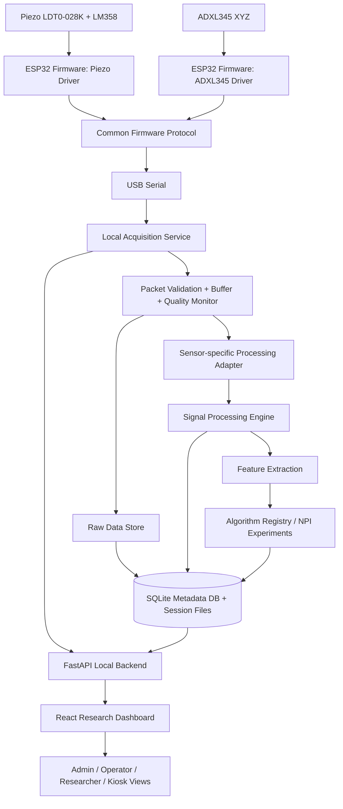

# NEUROPULSE — MVP SOFTWARE DEVELOPMENT MASTER SPECIFICATION

> **Tài liệu nguồn triển khai dành cho Antigravity / Claude Code / AI coding agents**  
> Phiên bản: 1.1
> Ngày lập: 13/10/2026 · Cập nhật: 22/10/2026
> Trạng thái: Draft kỹ thuật để triển khai MVP  
> Phạm vi: Firmware ESP32, ứng dụng thu thập dữ liệu, backend, dashboard nghiên cứu, xử lý tín hiệu, NPI experimentation, database, simulation và test.

---

## 0. Chỉ thị dành cho AI coding agent

Đọc toàn bộ tài liệu này trước khi sửa hoặc tạo mã nguồn. Đây là **nguồn yêu cầu thống nhất** cho MVP NeuroPulse. Không tự ý thay đổi kiến trúc, hợp đồng dữ liệu, công thức nghiên cứu hoặc thông số phần cứng chỉ để làm cho code chạy nhanh hơn.

### 0.1. Cách làm việc bắt buộc

1. Bắt đầu bằng việc tạo/kiểm tra repository, đọc tài liệu, lập implementation plan và chỉ ra các điểm còn thiếu. Không tạo toàn bộ ứng dụng trong một lần.
2. Chia công việc theo milestone và module. Mỗi module phải có interface, test và tiêu chí nghiệm thu trước khi chuyển tiếp.
3. Trước khi sửa một interface dùng chung, kiểm tra các module phụ thuộc và cập nhật tài liệu tương ứng.
4. Viết test cùng lúc với code. Không đánh dấu task hoàn thành chỉ vì ứng dụng khởi chạy được.
5. Không giả định thiết bị đang kết nối. Mọi module phải hoạt động ở chế độ mô phỏng khi chưa có phần cứng.
6. Không bịa dữ liệu, kết quả kiểm nghiệm, thông số hiệu chuẩn hoặc tính năng đã hoàn thành.
7. Không tự điền những thông số chưa được nhóm xác nhận. Đưa chúng vào `docs/OPEN_TECHNICAL_DECISIONS.md`, dùng cấu hình có thể thay đổi và ghi rõ giá trị tạm thời.
8. Khi gặp thiếu thông tin, ưu tiên tạo interface/configuration để chờ xác nhận thay vì hard-code một giả định khó thay đổi.
9. Không tự triển khai cloud, thanh toán, telemedicine, tài khoản công khai hoặc dịch vụ thu phí. MVP phải chạy local-first và không phát sinh phí dịch vụ.
10. Mọi dữ liệu mô phỏng phải được đánh dấu rõ ràng, không được hiển thị hoặc xuất như dữ liệu cảm biến thật.

### 0.2. Thứ tự ưu tiên khi có xung đột

1. An toàn người tham gia, quyền riêng tư và tính toàn vẹn dữ liệu.
2. Tài liệu này và các quyết định kỹ thuật đã được nhóm phê duyệt.
3. Data contract / protocol / test đã được chốt trong repository.
4. Tài liệu phần cứng và datasheet chính xác của linh kiện thực tế.
5. Đề xuất của AI coding agent.

Nếu hai tài liệu nguồn có thông tin mâu thuẫn, **không tự chọn một bên**. Ghi nhận xung đột và tạo cấu hình/decision record.

---

## 1. Tầm nhìn sản phẩm và mục tiêu MVP

### 1.1. Sản phẩm

NeuroPulse là hệ thống nghiên cứu gồm thiết bị đeo cổ tay và nền tảng phần mềm để thu thập, lưu trữ, xử lý và phân tích tín hiệu vi rung/chuyển động. Giả thuyết nghiên cứu ban đầu tập trung vào năng lượng tín hiệu trong dải 3–6 Hz và một chỉ số thử nghiệm gọi là NPI (NeuroPulse Index).

MVP phải chứng minh được **chuỗi kỹ thuật đầu-cuối**:

`Sensor → ESP32 Firmware → USB Serial → Local Acquisition → Data Validation → Raw Data Storage → Signal Processing → Feature Extraction → Experimental Algorithm/NPI → Dashboard/Export`

MVP không có mục tiêu chứng minh chẩn đoán hoặc sàng lọc Parkinson có độ chính xác lâm sàng. Đây là nền tảng thu thập và thử nghiệm tín hiệu/thuật toán nghiên cứu.

### 1.2. Trạng thái hiện tại được dùng để lập kế hoạch

Theo xác nhận mới nhất của nhóm, dự án đang ở giai đoạn ý tưởng và cần xây dựng lại firmware, dashboard và phần mềm từ đầu. Vì vậy:

- Không được coi firmware, module xử lý tín hiệu hoặc dashboard được nhắc là “đã có” trong bản mô tả dự án là đã hoàn thiện hay có thể tái sử dụng.
- Có thể tham khảo các tài liệu/bản thiết kế hiện tại, nhưng phải kiểm tra thực tế trước khi tái sử dụng bất kỳ code nào.
- Chưa có dữ liệu đo thực nghiệm.
- Dữ liệu mô phỏng là đầu vào chính để phát triển và kiểm thử phần mềm trước khi phần cứng hoàn thiện.
- Hai cấu hình cảm biến sẽ được mua và thử nghiệm song song; phần mềm phải hỗ trợ cả hai trước khi nhóm quyết định chọn phương án tốt hơn.

### 1.3. Mục tiêu nghiệm thu

Khi physical MVP hoàn thành, phần mềm cần có khả năng:

- Kết nối ESP32 bằng USB Serial.
- Nhận biết cấu hình cảm biến hoặc cho phép người vận hành chọn đúng profile.
- Tiếp nhận dữ liệu Piezo một kênh và ADXL345 ba trục.
- Kiểm tra packet, timestamp, sample index, sample rate và chất lượng tín hiệu.
- Lưu dữ liệu thô không phá hủy.
- Chạy pipeline xử lý có phiên bản/cấu hình rõ ràng.
- Thử nghiệm nhiều công thức/phiên bản NPI trên cùng một tập dữ liệu.
- Hiển thị waveform, PSD/spectrum, đặc trưng tín hiệu, chỉ số thử nghiệm và trạng thái chất lượng.
- Quản lý study/participant pseudonym/session/device/experiment.
- Xuất dữ liệu và báo cáo kỹ thuật có metadata đủ để tái lập kết quả.
- Chạy được hoàn toàn offline trên máy tính nhóm.

### 1.4. Không nằm trong phạm vi MVP

- Chẩn đoán Parkinson hoặc bất kỳ bệnh lý nào.
- Đưa ra nguy cơ mắc bệnh, xác suất mắc bệnh hoặc hướng dẫn điều trị.
- Tự động phân loại một người là khỏe mạnh/bệnh lý.
- Cloud hosting, đồng bộ đa cơ sở, SaaS thương mại hoặc thanh toán.
- Tích hợp hồ sơ bệnh án điện tử.
- Tuyên bố đạt chuẩn thiết bị y tế hoặc được chứng nhận lâm sàng.
- Hỗ trợ nhiều loại vi điều khiển ngoài ESP32 trong MVP (nhưng architecture không nên khóa cứng vào một loại thiết bị).

### 1.5. Cập nhật định hướng nhóm — 21/10/2026

Các quyết định dưới đây là cập nhật trực tiếp từ nhóm và ghi đè những phần mâu thuẫn trong bản spec ban đầu. Đây là cùng một sản phẩm dự kiến đi kèm vòng đeo tay khi phát hành; không thiết kế như demo dùng một lần. Giai đoạn hiện tại là phát triển và xác minh trên Windows 10/11 để thi KHKT, demo science fair, thử nghiệm phần mềm và so sánh cả hai cấu hình cảm biến. Mục tiêu thương mại/bệnh viện là định hướng tương lai, không phải trạng thái đã đạt hay phạm vi triển khai hiện tại.

- Thiết kế cả trải nghiệm bệnh nhân và các mode nhân viên/chuyên môn. Bệnh nhân nhập mã để mở hồ sơ cá nhân; nhân viên chọn mode trên máy. Trong prototype, các mode là giới hạn giao diện/thao tác, không được mô tả như xác thực danh tính hay bảo mật triển khai bệnh viện.
- Cả Piezo và ADXL345 phải được hỗ trợ để nhóm đo và so sánh trên cùng nền tảng.
- Hồ sơ prototype có patient code, tên, ngày sinh, giới tính khai báo với marker X/Y chỉ dùng theo quy ước mã, tiền sử cá nhân, tiền sử gia đình, chế độ ăn (chay/mặn), cùng các phiên đo, kết quả, cảnh báo demo và lịch sử. Marker không phải kết quả xét nghiệm nhiễm sắc thể. Những trường nhận dạng trực tiếp này được nhóm yêu cầu cho prototype; chỉ lưu local và phải chịu chính sách retention 3 tuần/giữ vô thời hạn đã nêu.
- Bệnh nhân xem số đo/kết quả live, biểu đồ, lịch sử và thông tin cá nhân. Các mode Admin, Researcher, Operator và Clinical Reviewer có thể xem dữ liệu toàn hệ thống theo giới hạn từng mode; Operator có quyền nghiên cứu như Researcher. Bác sĩ không cần một hệ thống tài khoản bệnh viện riêng trong prototype.
- Hệ thống tạo mã bệnh nhân để tra cứu local. Định dạng dự kiến: `N` + marker quy ước (`X` dùng cho nữ, `Y` dùng cho nam) + nhóm tuổi (`I`, `C`, `J`, `Y`, `M`, `E`) + hai số năm đo đầu tiên + năm chữ số ngẫu nhiên `00001–99999`. Mã không chứa năm sinh. Cần kiểm tra trùng mã khi cấp. Marker không khẳng định nhiễm sắc thể/karyotype; xử lý trường hợp giới tính chưa rõ/chưa khai báo hoặc ngoài hai lựa chọn hiện tại vẫn là quyết định mở.
- Mặc định giữ hồ sơ, raw/continuous recording, kết quả và lịch sử trong 3 tuần; Admin có thể bật lưu vô thời hạn cho nghiên cứu. Sau thời hạn, dữ liệu hết hạn phải được xóa theo chính sách đã cấu hình.
- Bệnh nhân chỉ xuất được dữ liệu cá nhân của mình. Các mode Admin, Clinical Reviewer, Operator và Researcher được xuất/xóa dữ liệu toàn hệ thống theo phạm vi prototype.
- Nhóm yêu cầu demo cảnh báo thật theo giả thuyết/ngưỡng có trong tài liệu trước. Handoff cũ ghi các dải NPI: `>=70` trong khoảng tham chiếu, `40–69` theo dõi, `<40` ngoài khoảng tham chiếu. Có thể dùng các dải này cho demo nghiên cứu theo yêu cầu mới của nhóm, nhưng phải gắn nhãn giả thuyết/thử nghiệm, lưu phiên bản quy tắc và không trình bày là xác nhận y khoa/lâm sàng. Clinical validation vẫn là công việc riêng.
- Thu thập với người tham gia thật chỉ bắt đầu sau khi nhóm có cố vấn chuyên môn, xin phép người tham gia và hoàn thành các phê duyệt/quy trình phù hợp.
- Ở giai đoạn hiện tại, dữ liệu đa máy/đồng bộ, dịch vụ thương mại và triển khai bệnh viện chưa được bật. Kiến trúc vẫn thuộc lộ trình của sản phẩm đeo tay cuối cùng; không loại bỏ nền tảng bằng cách đóng gói demo throwaway. Trước khi dùng chung hoặc phát hành cần hoàn thiện danh tính/phân quyền thực, bảo vệ dữ liệu, cài đặt/cập nhật, hỗ trợ vận hành, intended use/claim và các bằng chứng kiểm định thích hợp.
- Ứng dụng dành cho nhóm Windows được mở trong cửa sổ desktop riêng; không yêu cầu người dùng mở Chrome/Edge hoặc nhập địa chỉ localhost. Giao diện React được đóng gói trong ứng dụng Electron, còn API, SQLite và file đo vẫn chạy local. Đây là bước triển khai hiện tại của cùng sản phẩm; chưa đồng nghĩa với installer độc lập, nghiệm thu lâm sàng hay sẵn sàng bán.

### 1.5.1. Định hướng sản phẩm xuyên suốt — 22/10/2026

- Người dùng xác nhận mục tiêu từ đầu là sản phẩm đồng hành với vòng đeo tay, dự kiến phát hành đúng sản phẩm được phát triển qua các giai đoạn. Giai đoạn nghiên cứu/demo là bước phát triển hiện tại, không thay đổi đích đến sản phẩm.
- Các mode Admin, Operator, Researcher, Clinical Reviewer, Kiosk và Patient hiện được chuyển đổi trên máy để hỗ trợ demo/nghiên cứu; chưa khóa theo tài khoản cá nhân. Đây là quyết định cho giai đoạn hiện tại, không phải mô hình phân quyền đủ dùng khi phát hành hoặc triển khai tại bệnh viện.
- Thị trường đầu tiên, intended use/claim cuối cùng, chủ sở hữu phê duyệt y khoa và lộ trình pháp quy chưa được nhóm xác định. Không tự suy đoán hoặc quảng bá app hiện tại như thiết bị chẩn đoán/đã sẵn sàng thương mại; ghi các mục này vào `docs/OPEN_TECHNICAL_DECISIONS.md` và đóng trước các mốc phát hành tương ứng.

### 1.6. Cập nhật vận hành và hiển thị dữ liệu — 22/10/2026

- Người dùng yêu cầu app local mở thẳng vào **Patient mode** mặc định; bỏ sign-in trong prototype. Staff vẫn chọn Admin, Operator, Researcher, Clinical Reviewer hoặc Kiosk mode trên máy. Mode chỉ là giới hạn giao diện/thao tác, không phải xác thực và không được dùng làm ranh giới bảo mật.
- Dashboard phải vẽ chuỗi waveform từ dữ liệu phiên thực sự lưu. Nếu cửa sổ chưa đủ 8 giây để phân tích, vẫn có thể vẽ bản xem trước mẫu thô đã lưu nhưng phải giữ `INSUFFICIENT_DATA` và không phát sinh NPI.
- Staff cần trang thống kê tổng hợp lấy trực tiếp từ SQLite local, gồm số hồ sơ/phiên và biểu đồ mô tả theo nhóm tuổi, XX/XY, chế độ ăn. Trung bình NPI/TBR là trung bình theo phiên hoàn tất đã liên kết hồ sơ; phải hiển thị nguồn/provenance và không diễn giải như so sánh lâm sàng.
- Device simulator cần hai kịch bản phần mềm `Healthy` (tín hiệu tham chiếu ít năng lượng 3–6 Hz) và `Volatile` (tín hiệu tổng hợp có năng lượng 3–6 Hz cao hơn để thử luồng hiển thị/cảnh báo demo). Đây là cấu hình tổng hợp provisional, không phải mô phỏng bệnh nhân đã hiệu chuẩn, không đại diện người có nguy cơ; phải lưu scenario/config trong metadata raw và giữ provenance `simulated`.

### 1.7. Hiệu chỉnh vai trò bệnh nhân và bố cục phiên đo — 22/10/2026

- Patient mode là workspace tự đo và là mode mặc định khi mở app; không phải portal chỉ để tra cứu. Patient cũng xem waveform, kết quả, thông tin phiên và lịch sử cá nhân.
- Mã bệnh nhân đang chọn được hiển thị rõ. Mọi phiên mới được lưu với mã này; không cho đổi mã trong khi đang thu nhận. Mã có thể được nhập để mở hồ sơ hoặc được cấp tự động khi tạo hồ sơ mới.
- Bố cục phiên đo ưu tiên waveform live khi acquisition đang chạy; kết quả NPI thử nghiệm là vùng nổi bật; thông tin cá nhân của phiên và lịch sử nằm cạnh/bên dưới; nút bắt đầu/dừng dễ nhận biết.
- Patient chỉ nhận dữ liệu/phiên thuộc mã đang chọn, không có trang thống kê toàn hệ thống, phân tích nhóm, chi tiết thiết bị/raw kỹ thuật hay lab nghiên cứu. Kết quả NPI và cảnh báo vẫn mang nhãn giả thuyết thử nghiệm, không phải chẩn đoán.
- API mode patient chỉ đọc live buffer, phân tích lịch sử, bắt đầu hoặc dừng khi mã trong header khớp mã phiên/hồ sơ. Đây là phạm vi workflow local của prototype, không phải xác thực danh tính bảo mật.

### 1.8. Cập nhật nhịp đo live và thời lượng phiên — 22/10/2026

- Khi đo, waveform phải chạy/cập nhật liên tục theo tín hiệu thực nhận và cuộn trong cửa sổ gần nhất, trực quan như màn hình ECG; không dùng sóng minh họa hard-coded thay cho buffer acquisition.
- NPI thử nghiệm được tính lặp lại trên cửa sổ tín hiệu gần nhất sau khi đạt quality gate và đủ cửa sổ xử lý 8 giây. Trước thời điểm đó, chỉ hiển thị waveform cùng trạng thái chưa đủ dữ liệu; không hiển thị NPI hoặc cảnh báo dựa trên giá trị cũ.
- Phiên Patient mode tự dừng, lưu raw immutable và chốt kết quả sau 30 giây. Dừng thủ công vẫn được hỗ trợ. Provenance, quality flags và thông tin cấu hình phiên phải được giữ như các phiên khác.
- NPI live và các dải cảnh báo tiếp tục mang nhãn giả thuyết thử nghiệm, không phải chẩn đoán hoặc nguy cơ lâm sàng đã được xác nhận.

---

## 2. Phạm vi người dùng và quyền truy cập

Nhóm chọn **nhiều nhóm đối tượng sử dụng** trong định hướng MVP. Do đó, phần mềm cần phân biệt các vai trò và màn hình phù hợp. Tuy nhiên, để không làm chậm MVP, hệ thống dùng mô hình **local-first, role-based, không cần tài khoản cloud**.

### 2.1. Vai trò người dùng

| Vai trò | Mục đích | Quyền MVP |
|---|---|---|
| Admin | Chọn mode quản trị trên máy prototype | Quản lý cấu hình/retention; xem, export, xóa toàn bộ dữ liệu |
| Operator | Thực hiện phiên đo | Quyền xem nghiên cứu như Researcher; có thể bị giới hạn phiên trong phiên bản sau |
| Researcher | Phân tích dữ liệu và thống kê | Xem dữ liệu nghiên cứu, kỹ thuật, lâm sàng; export/xóa theo prototype scope |
| Clinical Reviewer | Xem kết quả dưới sự giám sát chuyên môn | Như staff research nhưng không thấy mã nguồn/mã kỹ thuật thiết bị; không cần tài khoản bệnh viện riêng |
| Patient | Tra cứu bằng patient code | Chỉ xem/export dữ liệu cá nhân, live results/charts, lịch sử và cảnh báo demo |

### 2.2. Quy tắc thực hiện quyền

- Prototype dùng patient-code lookup và mode selection trên máy, không yêu cầu cloud account hay đồng bộ máy.
- Staff modes là các giới hạn thao tác cho demo, không phải xác thực danh tính hoặc ranh giới bảo mật triển khai.
- Patient code mở hồ sơ cá nhân; bệnh nhân chỉ được xem/export hồ sơ gắn với mã đó.
- **Ngoại lệ prototype theo quyết định nhóm:** lưu tên và ngày sinh trong hồ sơ local để patient-code lookup và theo dõi cá nhân. Patient code chỉ là khóa tra cứu, không phải biện pháp xác thực hay ẩn danh.
- Các bộ dữ liệu xuất để thống kê/nghiên cứu nên dùng mã bệnh nhân và loại bỏ tên/ngày sinh nếu không cần thiết cho mục tiêu phân tích.
- Không xây dựng chức năng tự động đưa ra khuyến nghị y khoa.
- Mọi thao tác quan trọng (tạo session, bắt đầu/dừng, sửa metadata, thay algorithm version, export, xóa dữ liệu) phải có audit event.

### 2.3. Consent và nghiên cứu có người tham gia

Ứng dụng có thể lưu trạng thái `consent_recorded`, mã phiên bản biểu mẫu và timestamp, nhưng **không thay thế quy trình đồng thuận tham gia nghiên cứu**. Không thu thập dữ liệu người thật nếu chưa có sự chấp thuận/giám sát cần thiết, quy trình bảo vệ người tham gia và sự đồng ý hợp lệ. Việc thử nghiệm ban đầu nên được quản lý bởi người phụ trách nghiên cứu/cố vấn phù hợp; không sử dụng người tham gia để kiểm tra thiết bị chưa an toàn.

---

## 3. Hai cấu hình phần cứng phải được hỗ trợ

### 3.1. Sensor A — Piezoelectric

Cấu hình trong tài liệu ý tưởng:

`LDT0-028K Piezo Film → LM358 amplifier / analog front-end → ESP32 ADC → USB Serial`

Dữ liệu đầu vào dự kiến:

- Một kênh analog theo thời gian.
- Đại lượng phần cứng gốc: ADC counts.
- Có thể quy đổi sang voltage nếu đã xác nhận hệ số chuyển đổi, attenuation, reference/calibration và mạch analog thực tế.
- Tần số lấy mẫu 1000 Hz là mục tiêu được nêu trong tài liệu dự án, **chưa được xem là đã đạt hoặc đã xác nhận**.

Phần mềm cần lưu cả ADC counts gốc và thông tin chuyển đổi. Không được tự giả định một ADC count tương đương một điện áp cố định nếu chưa có calibration config.

### 3.2. Sensor B — ADXL345

Cấu hình trong tài liệu tối ưu chi phí:

`ADXL345 3-axis digital accelerometer → ESP32 I2C/SPI → USB Serial`

Dữ liệu đầu vào dự kiến:

- Ba kênh X, Y, Z.
- Lưu raw register/counts nếu firmware có thể cung cấp.
- Lưu scaled acceleration và đơn vị nếu đã cấu hình full-scale range/sensitivity đúng theo phần cứng.
- Output data rate phải là cấu hình có thể thay đổi và nằm trong giới hạn cảm biến.
- Không ép ADXL345 phải lấy mẫu 1000 Hz chỉ để giống cấu hình Piezo.

Pipeline phải hỗ trợ phân tích từng trục và các phép biến đổi đa trục được cấu hình. Không mặc định dùng vector magnitude làm tín hiệu duy nhất trước khi nhóm xác nhận phương pháp phân tích.

### 3.3. Không được giả định hai cảm biến tương đương

Piezo đo tín hiệu áp điện/điện áp phát sinh từ biến dạng hoặc rung động cơ học; ADXL345 đo gia tốc theo ba trục. Đơn vị, đáp ứng tần số, nhiễu, độ nhạy, cách gắn lên cổ tay và hiệu chuẩn khác nhau.

Yêu cầu bắt buộc:

- Có sensor adapter riêng.
- Có processing profile riêng.
- Giữ nguyên raw data và units nguồn.
- Không so sánh trực tiếp NPI giữa hai sensor như thể cùng thang đo cho đến khi có quy trình chuẩn hóa/hiệu chuẩn được nghiên cứu và xác nhận.
- Dashboard phải hiển thị rõ sensor type và acquisition configuration của mỗi session.

---

## 4. Kiến trúc hệ thống được chọn

### 4.1. Quyết định mặc định cho MVP

Nhóm chưa xác định việc xử lý dữ liệu trên thiết bị, máy tính hay cloud. Phương án tối ưu cho MVP là:

- **ESP32:** đọc cảm biến, timestamp/sample counter, đóng gói và truyền dữ liệu.
- **Máy tính local:** tiếp nhận Serial, validate, buffer, lưu raw data, xử lý tín hiệu, chạy NPI và cung cấp API.
- **Ứng dụng desktop Windows:** hiển thị giao diện React trong cửa sổ Electron qua origin cục bộ riêng; không yêu cầu trình duyệt bên ngoài.
- **Cloud:** không dùng trong MVP; chỉ thiết kế kiến trúc để sau này có thể bổ sung remote deployment.

Lý do: tập trung năng lực vào đo và kiểm nghiệm, không phát sinh chi phí server, giữ dữ liệu tại máy nghiên cứu, dễ debug và có thể vận hành khi offline.

### 4.2. Sơ đồ kiến trúc



### 4.3. Stack công nghệ đề xuất

Ưu tiên miễn phí, mã nguồn mở và chạy local.

| Layer | Công nghệ | Mục đích |
|---|---|---|
| Firmware | C/C++ với ESP-IDF; quản lý build bằng PlatformIO nếu tương thích | ESP32 drivers, timing, I2C/ADC, serial protocol |
| Communication | USB Serial; Python `pyserial` | Kết nối local |
| Backend | Python + FastAPI + Pydantic | API, session lifecycle, service orchestration |
| Acquisition | Python worker/service riêng, asynchronous queue | Đọc serial không chặn API/UI |
| Processing | NumPy + SciPy | Filtering, Welch PSD, FFT, feature extraction |
| Data analysis | pandas | Import/export và benchmark tables |
| Database | SQLite + SQLAlchemy + Alembic | Metadata, users, studies, sessions, algorithms, logs |
| Raw data files | HDF5 (`h5py`) hoặc chunked NPZ nếu HDF5 không phù hợp | Lưu chuỗi mẫu lớn theo session |
| Frontend | React + TypeScript + Vite, Electron desktop shell (Windows) | Giao diện desktop local |
| Charts | Plotly | Waveform, PSD, timeline, comparisons |
| UI components | Một bộ component mã nguồn mở được chọn thống nhất | Giao diện nhất quán |
| Testing | pytest, Vitest, Playwright (smoke/e2e) | Unit, integration và UI tests |
| Version control | Git + GitHub private repository hoặc Git local | Quản lý source |
| Packaging | Python venv/uv hoặc Poetry; Node package manager; PyInstaller chỉ khi phù hợp | Cài đặt local |

Không cần đăng ký API trả phí, cloud database, hosted analytics hay AI API trong runtime của sản phẩm. AI coding tool chỉ hỗ trợ phát triển; ứng dụng khi vận hành không phụ thuộc AI.

### 4.4. Cấu trúc monorepo đề xuất

```text
neuropulse/
├── README.md
├── AGENTS.md
├── .gitignore
├── .env.example
├── docs/
│   ├── ARCHITECTURE.md
│   ├── REQUIREMENTS.md
│   ├── DATA_CONTRACT.md
│   ├── SERIAL_PROTOCOL.md
│   ├── PROCESSING_PROFILES.md
│   ├── ALGORITHM_SPEC.md
│   ├── DATABASE_SCHEMA.md
│   ├── TEST_PLAN.md
│   ├── HARDWARE_INTEGRATION.md
│   ├── PRIVACY_AND_RESEARCH_SAFETY.md
│   └── OPEN_TECHNICAL_DECISIONS.md
├── firmware/
│   ├── platformio.ini
│   ├── common/
│   │   ├── protocol/
│   │   ├── device_info/
│   │   └── diagnostics/
│   ├── src/
│   │   ├── main.cpp
│   │   ├── drivers/
│   │   │   ├── piezo_adc/
│   │   │   └── adxl345/
│   │   └── acquisition/
│   └── test/
├── backend/
│   ├── pyproject.toml
│   ├── app/
│   │   ├── main.py
│   │   ├── api/
│   │   ├── core/
│   │   ├── models/
│   │   ├── schemas/
│   │   ├── services/
│   │   │   ├── device_manager/
│   │   │   ├── acquisition/
│   │   │   ├── storage/
│   │   │   ├── processing/
│   │   │   ├── algorithms/
│   │   │   ├── simulation/
│   │   │   └── reporting/
│   │   └── adapters/
│   │       ├── base.py
│   │       ├── piezo.py
│   │       └── adxl345.py
│   └── tests/
├── frontend/
│   ├── package.json
│   ├── src/
│   │   ├── app/
│   │   ├── pages/
│   │   ├── components/
│   │   ├── features/
│   │   ├── api/
│   │   ├── hooks/
│   │   ├── types/
│   │   └── styles/
│   └── tests/
├── shared/
│   ├── schemas/
│   └── fixtures/
├── data/
│   ├── simulated/
│   ├── imported_benchmark/
│   └── sessions/         # default local data directory; not committed
├── scripts/
│   ├── run_dev.sh
│   ├── run_dev.ps1
│   ├── generate_simulated_data.py
│   └── validate_environment.py
└── exports/
```

AI agent có thể đề xuất thay đổi cấu trúc nếu giải thích rõ lợi ích, tác động và migration; không tạo thêm framework chỉ vì sở thích cá nhân.

---

## 5. Firmware và giao thức giao tiếp

### 5.1. Trách nhiệm của firmware

Firmware chỉ thực hiện acquisition và device-level diagnostics:

- Khởi tạo ESP32 và cảm biến.
- Kiểm tra sensor presence/initialization.
- Đọc ADC cho Piezo hoặc XYZ registers cho ADXL345.
- Duy trì sample counter/sequence number.
- Ghi timestamp monotonic ở thiết bị nếu phù hợp.
- Đóng gói sample batches.
- Gửi qua USB Serial.
- Nhận lệnh cấu hình/start/stop/status.
- Báo lỗi cảm biến, buffer overflow hoặc sampling fault.

Firmware **không** tính NPI, không chạy FFT/Welch, không tự kết luận trạng thái sinh học và không làm mất raw data.

### 5.2. Command set đề xuất

Tên command có thể được chốt trong `SERIAL_PROTOCOL.md` nhưng cần có các hành vi sau:

| Command | Mục đích |
|---|---|
| `HELLO` / `GET_INFO` | Nhận device identity, firmware version, sensor type, capabilities |
| `GET_STATUS` | Trạng thái cảm biến, buffer, acquisition |
| `CONFIGURE` | Cấu hình sensor, ODR/sample rate, batch size và scale nếu hỗ trợ |
| `START_STREAM` | Bắt đầu acquisition |
| `STOP_STREAM` | Dừng acquisition an toàn |
| `PING` | Kiểm tra đường truyền |
| `RESET_STREAM` | Đồng bộ lại bộ đếm/stream nếu được thiết kế và kiểm thử |

### 5.3. Data packet

Thiết kế protocol cần ưu tiên tính toàn vẹn và hiệu quả ở tốc độ lấy mẫu cao. Không dùng một dòng JSON cho từng sample làm protocol mặc định khi streaming liên tục; JSON có thể dùng cho command/debug.

Packet dữ liệu đề xuất có các trường logic sau:

- Magic/sync bytes.
- Protocol version.
- Message type.
- Device ID hoặc device session identifier.
- Sensor type.
- Sequence number.
- First sample index.
- First sample timestamp (monotonic microseconds hoặc đơn vị đã công bố).
- Sample interval hoặc sample-rate configuration identifier.
- Channel count và channel identifiers.
- Sample count trong batch.
- Payload chứa raw values theo channel.
- CRC/checksum.

Chọn encoding nhị phân có framing và checksum (ví dụ frame-length + CRC16, hoặc COBS + CRC) sau khi kiểm tra khả năng triển khai ổn định. Tạo một `protocol simulator` bằng Python và fixture packet để test parser trước khi có hardware.

### 5.4. Yêu cầu timing và sampling

- Dùng hardware timer/peripheral phù hợp, không dùng vòng lặp `delay()` làm chuẩn timing cho sampling chính xác.
- Đối với Piezo, 1000 samples/s là target được nêu trong đề xuất; xác nhận bằng đo thực tế.
- Đối với ADXL345, cấu hình output data rate theo datasheet, yêu cầu phân tích và giới hạn truyền dữ liệu; không ép bằng target Piezo.
- Ghi lại sample index để phát hiện drop/duplicate.
- Thu timestamp monotonic để đo jitter/interval; không dùng giờ hệ điều hành làm nguồn timing cho từng sample.
- Kiểm tra buffer overflow và packet loss.
- Firmware phải có trạng thái lỗi rõ ràng, không im lặng bỏ mẫu.
- Không nội suy mẫu bị mất trong raw data. Nếu downstream tạo dữ liệu nội suy để phân tích phụ, phải lưu riêng và gắn nhãn.

### 5.5. Thiết kế driver

Cần có interface chung ở mức firmware, ví dụ:

```cpp
class SensorDriver {
public:
    virtual bool begin() = 0;
    virtual bool configure(const SensorConfig& config) = 0;
    virtual bool readBatch(SampleBatch& batch) = 0;
    virtual SensorStatus getStatus() = 0;
    virtual const SensorCapabilities& capabilities() = 0;
    virtual ~SensorDriver() = default;
};
```

Đây là interface định hướng; AI agent có thể điều chỉnh cho phù hợp với framework firmware đã chọn.

### 5.6. Điểm cần kiểm tra trên phần cứng thật

- Piezo + LM358: gain, bias/offset, input/output range, noise, clipping và bảo vệ ADC.
- ESP32 ADC: board/variant thực tế, attenuation, độ tuyến tính, effective resolution, calibration và giới hạn điện áp.
- ADXL345: địa chỉ I2C, wiring, ODR, full-scale range, sensitivity và XYZ conversion.
- Nguồn, ground, shielding, strain relief và cách cố định cảm biến.
- Không kết nối tín hiệu analog vượt mức an toàn của ADC. Firmware không thể thay thế thiết kế analog front-end đúng.

---

## 6. Data contract chuẩn

Data contract là ranh giới quan trọng giữa firmware, acquisition, processing và dashboard. Thay đổi contract phải có version và test.

### 6.1. Logical sensor sample model

```json
{
  "schema_version": "1.0",
  "device_id": "NP-DEV-001",
  "firmware_version": "0.1.0",
  "sensor_type": "ADXL345",
  "signal_type": "acceleration",
  "channel_names": ["x", "y", "z"],
  "raw_unit": "counts",
  "physical_unit": "m/s^2",
  "sample_rate_config_hz": 100,
  "sample_index_start": 0,
  "timestamp_start_monotonic_us": 1000000,
  "sample_count": 4,
  "data": {
    "x": [1, 2, 3, 4],
    "y": [0, 1, 1, 0],
    "z": [10, 10, 11, 10]
  },
  "provenance": "simulated"
}
```

Đây là ví dụ logic minh họa, không phải serial packet encoding hoặc thông số phần cứng đã được xác nhận.

### 6.2. Trường dữ liệu bắt buộc

| Trường | Ý nghĩa |
|---|---|
| `schema_version` | Version hợp đồng dữ liệu |
| `device_id` | ID thiết bị |
| `firmware_version` | Firmware đã tạo dữ liệu |
| `sensor_type` | `PIEZO_LDT0_028K`, `ADXL345` hoặc loại khác được đăng ký |
| `signal_type` | `voltage`, `acceleration` hoặc kiểu được định nghĩa |
| `channel_names` | Danh sách kênh theo đúng thứ tự |
| `raw_unit` | Đơn vị/raw representation nguồn |
| `physical_unit` | Đơn vị vật lý nếu đã hiệu chuẩn; nullable nếu chưa biết |
| `sample_rate_config_hz` | Cấu hình tần số lấy mẫu/ODR |
| `sample_index_start` | Sample index đầu batch |
| `timestamp_start_monotonic_us` | Timestamp monotonic bắt đầu batch |
| `sample_count` | Số mẫu trong batch |
| `data` | Mảng dữ liệu theo channel |
| `provenance` | `simulated`, `device`, `imported_benchmark`, `reprocessed` |

Các trường bổ sung: gain, ADC attenuation, sensor range, calibration ID, packet sequence, dropped samples, firmware build hash và device configuration.

### 6.3. Nguyên tắc dữ liệu

- Raw data là bất biến sau khi đã ghi; chỉ được thêm annotation hoặc tạo processed derivative.
- Mỗi processed result phải tham chiếu đến raw recording ID/hash.
- Mỗi kết quả NPI phải tham chiếu algorithm version + config snapshot + processing profile.
- Không dùng `participant_name` làm khóa dữ liệu.
- Phải lưu provenance ở mức dataset, session và file.
- Mọi thao tác sửa metadata phải có audit log.

---

## 7. Acquisition Service trên máy tính

### 7.1. Trách nhiệm

- Liệt kê cổng Serial và trạng thái cổng.
- Kết nối/ngắt kết nối có kiểm soát.
- Gửi command và nhận device info.
- Parse packet và validate protocol.
- Đưa samples vào bounded queue/buffer.
- Ghi raw data theo batch/chunk song song với streaming.
- Cập nhật diagnostics theo thời gian thực.
- Phục hồi sau mất kết nối và báo trạng thái rõ ràng.
- Hỗ trợ simulator mà không cần thiết bị thật.

### 7.2. Không được làm

- Không thực hiện xử lý nặng đồng bộ trong thread đọc Serial.
- Không để cập nhật UI quyết định tốc độ đọc Serial.
- Không âm thầm bỏ packet khi UI chậm.
- Không giữ toàn bộ raw samples trong RAM suốt phiên đo dài.

### 7.3. Buffering và backpressure

Kiến trúc nên có các worker tách biệt:

1. Serial reader.
2. Packet decoder/validator.
3. Raw writer.
4. Processing worker.
5. Websocket/event publisher cho UI.

Queue cần có giới hạn và chính sách khi đầy: ghi cảnh báo, đánh dấu data loss và dừng phiên đo an toàn nếu không đảm bảo lưu đủ dữ liệu. Mọi mất mẫu phải hiện diện trong session quality report.

### 7.4. Diagnostics trong Live Sensing

- Device connected/disconnected.
- Sensor initialized / sensor error.
- Configured sample rate / measured effective sample rate.
- Packet rate.
- Packet CRC errors.
- Sequence gaps / dropped samples.
- Buffer utilization.
- ADC clipping/saturation (Piezo, nếu xác định được ngưỡng raw).
- Stuck signal / constant values.
- Missing channel / malformed packet.
- Timestamp interval variation/jitter.
- Acquisition duration và số mẫu đã nhận.

---

## 8. Signal Processing Engine

### 8.1. Pipeline chuẩn

```text
Raw Samples
  → Data Integrity Check
  → Sensor-specific Unit/Calibration Mapping (nếu đủ thông tin)
  → Detrending / DC Handling
  → Configurable Filtering
  → Windowing
  → FFT / Welch PSD
  → Band Power & Signal Features
  → Experimental Algorithm / NPI
  → Result + Quality Metadata
```

Không ghi đè raw data ở bất kỳ bước nào.

### 8.2. Sensor-specific processing profiles

Mỗi profile cần version và có thể cấu hình:

- Sensor type.
- Channels included.
- Unit and calibration reference.
- Detrend mode.
- Filter type/order/cutoff.
- Notch settings, nếu có căn cứ.
- Window length.
- Overlap.
- PSD method and parameters.
- Band definitions.
- Feature selection.
- Quality thresholds.

### 8.3. Các thông tin cần cấu hình, không hard-code

Tài liệu NeuroPulse hiện có một số thông số khởi điểm nhưng chưa hoàn toàn thống nhất:

| Nội dung | Thông tin trong tài liệu | Cách triển khai |
|---|---|---|
| Piezo sampling | Khoảng 1000 Hz | Dùng làm target cần kiểm tra; lưu measured rate thực tế |
| Analysis window | 8 giây | Giá trị cấu hình khởi điểm, có thể thay đổi |
| Frequency denominator | 1–20 Hz trong phần mô tả xử lý và TBR | Cấu hình rõ ràng |
| Filter passband | 5–20 Hz ở phần tóm tắt; 1–20 Hz ở phần chi tiết | **Xung đột tài liệu**; cần nghiên cứu xác nhận, hỗ trợ profile thử nghiệm riêng |
| Target band | 3–6 Hz | Giữ là band nghiên cứu ban đầu, không coi là dấu hiệu chẩn đoán |
| Mains notch | 50 Hz nếu cần | Có thể bật/tắt; xác định thứ tự lọc và lý do. Không áp dụng máy móc nếu bước lọc khác đã loại vùng 50 Hz |
| Welch settings | Chưa chốt đầy đủ | Expose window/segment/overlap/scaling trong config và lưu metadata |
| ADXL345 ODR | Chưa chốt | Cấu hình theo khả năng cảm biến và thử nghiệm vật lý |

### 8.4. Signal features cần hỗ trợ

Tùy sensor profile và khả năng dữ liệu, hỗ trợ:

- Mean, median, standard deviation.
- RMS.
- Peak-to-peak amplitude.
- Dominant frequency.
- PSD/frequency spectrum.
- Band power (bao gồm 3–6 Hz và 1–20 Hz nếu dữ liệu/phương pháp cho phép).
- TBR = `power(3–6 Hz) / power(1–20 Hz)` theo định nghĩa trong đề xuất ban đầu.
- Signal quality features: clipping ratio, missing sample ratio, noise estimates, flatline, jitter.
- Multi-axis features cho ADXL345, nhưng từng feature phải ghi rõ cách tổng hợp trục.

Đảm bảo cách tính band power rõ ràng (tích phân PSD theo dải, quy ước biên dải, đơn vị, scaling) và có test bằng tín hiệu tổng hợp.

### 8.5. Windowing

- Dùng 8 giây làm cấu hình mặc định ban đầu theo tài liệu.
- Có thể hỗ trợ non-overlapping hoặc overlapping windows; overlap phải lưu trong profile.
- Nếu sample count không đủ cho một window, trạng thái phải là `INSUFFICIENT_DATA`, không trả NPI giả.
- Không trộn sample rate khác nhau trong cùng window nếu chưa có resampling policy.
- Nếu cần resampling, giữ original sample data và lưu rõ phương pháp + rate đích.

### 8.6. Xử lý riêng cho ADXL345

- Có thể phân tích X, Y, Z độc lập.
- Có thể cung cấp vector magnitude / vector norm như một derived channel tùy chọn.
- Cần quyết định có loại bỏ gravity/DC hay không dựa trên protocol đo và mục tiêu khoa học.
- Không gộp ba trục và bỏ raw axis data.
- Lưu phép biến đổi, hướng gắn thiết bị và sensor orientation metadata nếu nhóm có quy trình xác định.

### 8.7. Quality gate

Mỗi window/session cần trạng thái chất lượng, ví dụ:

- `VALID_FOR_ANALYSIS`
- `WARNING`
- `INVALID`
- `INSUFFICIENT_DATA`

Lý do phải có cấu trúc, ví dụ `ADC_CLIPPING`, `SAMPLE_GAP`, `RATE_DEVIATION`, `LOW_SIGNAL`, `FLATLINE`, `PACKET_CORRUPTION`.

Không được tính hoặc hiển thị kết quả như bình thường nếu quality gate đánh dấu invalid. Có thể hiển thị kết quả nghiên cứu ở trạng thái warning nhưng phải gắn cảnh báo rõ ràng.

---

## 9. NPI và Algorithm Experimentation Lab

### 9.1. Nguyên tắc

NPI là chỉ số thử nghiệm do nhóm đề xuất, chưa được xác thực lâm sàng. NPI phải được triển khai như một **plugin/versioned research algorithm**, không được coi là medical diagnostic score.

### 9.2. Những gì đã xác định trong tài liệu

- `TBR = power(3–6 Hz) / power(1–20 Hz)`.
- NPI có thang trình bày 0–100 theo đề xuất.
- Mô tả định tính: năng lượng tập trung nhiều hơn ở dải 3–6 Hz thì NPI thấp hơn.
- Các giá trị 0.40 và 0.85 là ngưỡng/điểm khởi đầu dùng kiểm thử phần mềm và có thể được hiệu chuẩn lại hoặc loại bỏ.

**Quyết định cập nhật ngày 21/10/2026:** Nhóm đã phê duyệt công thức được trích từ tài liệu Word nguồn cho mục đích **experimental research use**. Đăng ký thành `NPI_v1_baseline` với công thức và tham số sau; không diễn giải như chẩn đoán, xác suất/risk score hay kết luận lâm sàng:

```text
NPI = 100 * [1 - clip((TBR - tbr_min) / (tbr_max - tbr_min), 0, 1)]
tbr_min = 0.40
tbr_max = 0.85
```

Các tham số này là điểm khởi đầu thử nghiệm và phải được lưu theo từng algorithm run. **Cập nhật 21/10/2026:** theo chỉ đạo mới của nhóm, demo prototype cần có cảnh báo theo các dải NPI `>=70`, `40–69`, `<40` được ghi trong handoff trước đó. Chỉ sử dụng các dải này như giả thuyết/ngưỡng demo nghiên cứu, có nhãn cảnh báo rõ ràng và phiên bản quy tắc; chúng chưa được xác nhận lâm sàng và không được gọi là xác suất mắc bệnh hoặc chẩn đoán. Đây là quyết định prototype tạm thời, thay cho trạng thái “không hiển thị dải” trước đây; việc xác nhận lâm sàng vẫn mở.

### 9.3. Algorithm Registry

Mỗi algorithm version cần có:

- `algorithm_id`
- `version`
- `display_name`
- `description`
- `status`: draft / experimental / approved_for_research / retired
- `sensor_compatibility`
- `input_features`
- `formula_reference` hoặc code reference
- `parameters_schema`
- `default_parameters`
- `output_schema`
- `created_at`, `created_by`
- `change_notes`
- `validation_notes`

### 9.4. Algorithm Lab functions

- Tạo algorithm config mới từ một version.
- Chỉnh tham số mà không sửa raw data.
- Lưu snapshot cấu hình.
- Chạy nhiều phiên bản trên cùng dataset/session.
- So sánh output và feature values.
- Xem nguồn dữ liệu, processing profile và quality flags.
- Ghi chú thay đổi và lý do.
- Khôi phục config cũ.
- Export results kèm đầy đủ metadata.

### 9.5. Không làm trong MVP

- Không dùng machine learning classifier để kết luận Parkinson.
- Không đưa ra risk score cá nhân.
- Không tối ưu threshold để “tách nhóm” nếu chưa có dataset, reference labels và protocol được xác lập.
- Không coi benchmark correlation hoặc sự khác biệt thống kê là bằng chứng chẩn đoán.

---

## 10. Simulation và synthetic datasets

Vì chưa có dữ liệu đo, simulation là yêu cầu lõi chứ không phải tính năng phụ.

### 10.1. Signal generator

Tạo bộ sinh dữ liệu có cấu hình:

- Sine wave đơn tần.
- Multi-sine / composite signals.
- Tần số và biên độ có thể thay đổi.
- White noise và noise bands.
- Drift/DC offset.
- Clipping/saturation.
- Dropout/missing samples.
- Sampling jitter.
- Flatline/stuck sensor.
- Frequency sweep hoặc burst signal.
- ADXL345 synthetic XYZ với mỗi trục có tín hiệu khác nhau.
- Piezo synthetic single-channel voltage/counts.

Không gắn các dạng synthetic waveform với nhãn Parkinson hoặc người bệnh thật. Dùng nhãn kỹ thuật như `SYNTHETIC_CASE_01`, `KNOWN_FREQUENCY_5HZ`, `CLIPPING_CASE`.

### 10.2. Simulator acceptance

- Có thể sinh tín hiệu ở sample rate và duration cấu hình.
- Có ground-truth parameters để test FFT/PSD.
- Có thể phát dữ liệu qua cùng data contract như hardware.
- Dashboard luôn hiện banner `SIMULATED DATA`.
- Mọi record/file được provenance=`simulated`.
- Không cho import synthetic data vào study thật mà không có cảnh báo và xác nhận.

---

## 11. Backend, database và lưu trữ

### 11.1. Các domain entity

| Entity | Mục đích / trường chính |
|---|---|
| LocalUser | username, password hash, role, enabled, created_at |
| Study | study_code, title, protocol_version, description, status |
| Participant | pseudonymous participant_code, study_id, consent_status, metadata tối thiểu |
| Device | device_id, board_type, sensor_type, firmware_version, hardware_revision |
| SensorConfiguration | sensor config, calibration config, profile ID, version |
| Session | session_id, study_id, participant_id, device_id, operator_id, start/end, provenance, status |
| RawRecording | path, file hash, sample count, channel metadata, integrity status |
| ProcessingRun | raw recording ref, processing profile version, software version, status |
| FeatureSet | processing run ref, feature values, units, quality flags |
| AlgorithmVersion | algorithm metadata, code/config version, status |
| AlgorithmRun | feature set ref, algorithm version, parameter snapshot, result |
| Annotation | session/window reference, author, note, timestamp |
| AuditEvent | actor, action, entity, timestamp, detail |
| AppSetting | local settings, data root, serial config |

### 11.2. Lưu trữ khuyến nghị

- SQLite: metadata, users, studies, participants pseudonymized, sessions, configuration, results, audit logs.
- HDF5 hoặc chunked binary/NPZ: raw samples và processed time series lớn.
- CSV/JSON: export trao đổi dữ liệu.
- Không lưu toàn bộ sample arrays trong một SQLite row.
- Mỗi session có folder riêng theo UUID, không dùng participant name trong đường dẫn.

Cấu trúc file đề xuất:

```text
data/sessions/<session_uuid>/
├── manifest.json
├── raw.h5
├── processing/
│   ├── run_<processing_run_id>.h5
│   └── features.json
├── algorithms/
│   └── run_<algorithm_run_id>.json
├── logs/
│   └── acquisition.log
└── exports/
```

### 11.3. Reproducibility

Mỗi result cần đủ thông tin để tái lập:

- Raw file checksum.
- Data schema version.
- Device ID / firmware version.
- Sensor type and configuration.
- Calibration version.
- Measured sample rate and sample gaps.
- Processing profile ID/version.
- Software version / Git commit hash.
- Algorithm ID/version.
- Parameter snapshot.
- Quality flags.
- Timestamp and operator pseudonym/local user ID.

### 11.4. Database migration và backup

- Dùng migration tool; không thay đổi schema thủ công mà không có migration.
- Có chức năng backup database + session files.
- Có chức năng restore vào thư mục mới và validate integrity.
- Không tự xóa raw data khi xóa một kết quả phân tích.
- Xóa dữ liệu phải yêu cầu quyền Admin và ghi audit event.

---

## 12. Research Dashboard — chức năng và UX

### 12.1. Navigation

MVP đề xuất các khu vực:

1. Overview.
2. Device & Connection.
3. Live Sensing.
4. Signal Analysis.
5. Algorithm Lab.
6. Studies & Participants.
7. Sessions & History.
8. Benchmark / Import.
9. Reports & Export.
10. Settings / Audit Log.

### 12.2. Overview

Hiển thị:

- Số lượng study/session/dataset theo provenance.
- Device state và sensor configuration gần nhất.
- Phiên gần nhất và lỗi cần chú ý.
- Trạng thái processing/algorithm versions.
- Shortcut đến Live Sensing và Algorithm Lab.

Không hiển thị KPI có ý nghĩa y khoa chưa được xác thực.

### 12.3. Device & Connection

- Serial port selector.
- Baud rate/configuration selector phù hợp protocol.
- Scan/refresh ports.
- Connect/disconnect.
- Device info/firmware/sensor type.
- Ping/status.
- Sensor initialization result.
- Selected sensor profile.
- Connection log và troubleshooting hints.

### 12.4. Live Sensing

- Study và participant pseudonym selection.
- Device/session setup.
- Consent status check (không thay thế consent process).
- Start/Stop recording.
- Raw live waveform theo từng channel.
- Optional filtered live waveform.
- Effective sample rate.
- Packet loss/sequence gaps.
- Buffer status.
- ADC clipping/signal flatline/missing channel warnings.
- Elapsed time/sample count.
- Prominent `SIMULATED` hoặc `REAL DEVICE` indicator.

Không tự động bắt đầu đo khi trang vừa mở. Người vận hành phải xác nhận đúng device/sensor/session trước khi ghi.

### 12.5. Signal Analysis

- Raw vs filtered waveform.
- PSD/Welch và spectrum.
- Highlight band 3–6 Hz.
- Hiển thị denominator band 1–20 Hz nếu đúng profile.
- Feature table có units.
- Window timeline.
- Quality flags theo từng window.
- Axis selection cho ADXL345.
- Không gộp khác sensor type trên cùng một chart mà không phân biệt rõ.

### 12.6. Algorithm Lab

- Danh sách algorithm versions.
- Form tham số có schema validation.
- Chọn dataset/session.
- Run / cancel analysis.
- Compare algorithms.
- Hiển thị TBR, NPI và feature outputs theo version.
- Cảnh báo khi formula pending hoặc algorithm draft.
- Lưu experiment note.

NPI chỉ được hiển thị dưới nhãn `Experimental Research Index`; không hiển thị `Normal`, `Abnormal`, `Parkinson positive`, `Parkinson negative` hoặc khuyến nghị điều trị.

### 12.7. Studies & Participants

- Tạo study code.
- Tạo participant pseudonym code.
- Lưu metadata tối thiểu cần thiết cho protocol nghiên cứu đã được duyệt.
- Consent status/version/timestamp.
- Không thu thập danh tính trực tiếp mặc định.
- Participant Kiosk Mode cung cấp hướng dẫn thao tác trung lập, không phơi bày NPI.

### 12.8. Sessions & History

- Filter theo study, sensor type, date, device, operator, provenance, quality status.
- Xem session metadata.
- Xem waveform/features/algorithm runs.
- Reprocess raw data bằng profile mới mà không ghi đè kết quả cũ.
- Duplicate analysis configuration.
- Archive/export.

### 12.9. Benchmark / Import

- Import CSV/JSON/NPY/NPZ và các format được hỗ trợ rõ ràng.
- Mapping wizard để map columns → channels/timestamps/units.
- Validate sample rate, missing data và metadata.
- Gắn provenance=`imported_benchmark`.
- Không tự suy đoán đơn vị hoặc sensor type khi không có metadata; yêu cầu user xác nhận.
- Lưu nguồn dữ liệu/license/source note nếu có.

### 12.10. Reports & Export

Có thể xuất:

- Raw data (CSV/NPZ/HDF5 tùy quy mô).
- Processed waveform.
- PSD/feature tables.
- Algorithm outputs.
- Session manifest.
- Quality report.
- Experiment comparison report.

Mọi report có header chỉ rõ: `RESEARCH / EXPERIMENTAL — NOT FOR DIAGNOSIS`, provenance, sensor type, processing version, algorithm version và quality warnings.

---

## 13. API design

FastAPI routes cần có version prefix `/api/v1`.

Endpoint groups đề xuất:

```text
/api/v1/health
/api/v1/auth/local-login
/api/v1/users
/api/v1/devices
/api/v1/devices/ports
/api/v1/devices/connect
/api/v1/devices/disconnect
/api/v1/devices/status
/api/v1/acquisition/start
/api/v1/acquisition/stop
/api/v1/acquisition/status
/api/v1/studies
/api/v1/participants
/api/v1/sessions
/api/v1/sessions/{id}/raw
/api/v1/sessions/{id}/analysis
/api/v1/processing/profiles
/api/v1/processing/runs
/api/v1/algorithms
/api/v1/algorithms/{id}/versions
/api/v1/algorithm-runs
/api/v1/benchmarks/import
/api/v1/exports
/api/v1/audit-events
/api/v1/settings
```

Yêu cầu:

- Pydantic schema cho request/response.
- Typed errors, HTTP status code đúng.
- API không mở ra Internet mặc định; bind `127.0.0.1` trong local mode.
- CORS chỉ cho frontend local origin.
- WebSocket hoặc Server-Sent Events cho realtime status/plot updates; không gửi toàn bộ raw stream cho browser khi không cần.
- Có OpenAPI docs nội bộ.
- Không đưa file path tùy ý từ request vào hệ thống file; validate path và chống path traversal.

---

## 14. Privacy, security và research safeguards

- Local-first; không gửi dữ liệu về cloud/analytics bên thứ ba.
- Không lưu PII mặc định.
- Pseudonymous participant ID.
- Mật khẩu local phải được hash bằng thuật toán phù hợp; không lưu plain text.
- Giới hạn quyền theo role.
- Audit các thay đổi quan trọng.
- Backup phải giữ cùng mức bảo vệ với dữ liệu gốc.
- Export hiển thị cảnh báo về dữ liệu nhạy cảm và provenance.
- Không tự động đưa ra kết luận y khoa.
- Màn hình và báo cáo phải có thông báo nghiên cứu, không phải công cụ chẩn đoán.
- Chỉ thu thập dữ liệu con người khi có sự đồng ý hợp lệ, quy trình được phê duyệt và giám sát phù hợp. Không xem mô phỏng là bằng chứng lâm sàng.

---

## 15. Testing & Validation Plan

### 15.1. Firmware tests

- Protocol encode/decode fixtures.
- Command parsing.
- Device initialization success/failure.
- Sample counter monotonicity.
- Sequence number behavior.
- Buffer overflow detection.
- Sensor unplugged/error handling.
- Configuration validation.
- Build test cho từng target board thực tế.

### 15.2. Backend tests

- Serial parser valid/invalid/corrupt packet.
- Reconnection and disconnect.
- Queue/backpressure.
- Raw file writer and checksum.
- Database repository and migrations.
- Session lifecycle.
- Permission tests.
- Algorithm parameter validation.
- Processing pipeline deterministic fixtures.

### 15.3. Signal processing tests

Tạo synthetic signals có ground truth:

- 2 Hz, 3 Hz, 5 Hz, 6 Hz, 10 Hz, 18 Hz, 25 Hz.
- Multi-tone mixtures.
- Known amplitudes.
- White noise.
- DC offset and drift.
- Clipping.
- Missing samples.
- Sampling jitter.

Test xác nhận:

- Frequency peak đúng trong tolerance được định nghĩa.
- Band power tính đúng theo convention.
- Filter response đúng với cấu hình.
- Welch PSD output finite, đúng shape và scale.
- Missing data không bị âm thầm xem như zero.
- Invalid window không tạo NPI hợp lệ.
- Cùng raw data + cùng config + cùng code version cho kết quả tái lập trong tolerance.

Tolerance phải do test specification xác định, không để AI tự đặt theo output đang có.

### 15.4. Frontend tests

- Page smoke tests.
- Loading/empty/error states.
- Device disconnected states.
- Simulated vs real data labels.
- Start/stop measurement state.
- Permission-based UI.
- Large dataset pagination/plot downsampling.
- No diagnosis/clinical language in user-facing text.

### 15.5. Integration tests

- Simulator → backend → storage → dashboard.
- Protocol fixtures → parser → acquisition queue.
- Recording → raw file → re-open → reprocess.
- Two sensor fixtures → correct adapter/profile.
- Reprocess with different algorithm versions.
- Backup → restore → integrity check.

### 15.6. Hardware-in-the-loop tests

Sau khi linh kiện về:

- Piezo branch: sensor read, ADC range, bias, sample rate, clipping, noise, repeatability.
- ADXL345 branch: I2C/SPI, chip identity, XYZ output, range, ODR, scale conversion.
- USB Serial packet integrity and throughput.
- Disconnect/reconnect behavior.
- 1-minute, 5-minute và thời lượng stress test phù hợp.
- Verify raw file sample count against device counters.
- So sánh acquisition duration, measured rate, missing samples và signal quality của cả hai nhánh.

Hardware-in-the-loop checks chỉ xác nhận hệ thống kỹ thuật. Không diễn giải kết quả thành hiệu quả y khoa.

---

## 16. Definition of Done

Một module chỉ được đánh dấu `DONE` khi:

- Code nằm đúng module và tuân theo interface.
- Có type checking/lint phù hợp.
- Unit tests pass.
- Integration tests liên quan pass.
- Error handling có kiểm thử.
- Logging không tiết lộ dữ liệu định danh.
- Documentation được cập nhật.
- Không còn TODO quan trọng bị che giấu.
- Không có hard-coded giả định khoa học/phần cứng chưa duyệt.
- Có hướng dẫn chạy/kiểm thử.

Một milestone chỉ hoàn thành khi toàn bộ acceptance criteria của milestone đạt, không chỉ khi màn hình demo được.

---

## 17. Roadmap triển khai đề xuất

Kế hoạch tham chiếu 12 tuần, có thể điều chỉnh theo nguồn lực. Phần mềm và phần cứng phát triển song song; tuần 10–12 phụ thuộc vào việc nhóm có linh kiện/mạch hoạt động.

| Giai đoạn | Thời gian | Công việc | Deliverable / Gate |
|---|---:|---|---|
| M0 — Project Foundation | Tuần 1 | Repo, architecture, data contract, open decisions, dev environment, CI | Repo chạy được, docs được duyệt |
| M1 — Protocol & Firmware Skeleton | Tuần 2 | Common protocol, simulator fixtures, ESP32 skeleton, device info/status | Firmware build + parser test |
| M2 — Dual Sensor Abstraction | Tuần 3 | Piezo/ADXL drivers interfaces, profiles, synthetic data adapters | Hai luồng simulated dùng chung contract |
| M3 — Acquisition Service | Tuần 4 | Serial manager, parser, queue, raw writer, diagnostics | Simulator chạy end-to-end |
| M4 — Signal Processing | Tuần 5 | Filters, Welch/FFT, windows, features, quality gates | Processing tests pass |
| M5 — Algorithm Lab | Tuần 6 | Algorithm registry, parameter schema, versioning, NPI pending plugin | Multiple configs chạy được trên cùng dataset |
| M6 — Backend & Data | Tuần 7 | FastAPI, SQLite, migrations, sessions, studies, audit | Data persistence và API ổn định |
| M7 — Dashboard Core | Tuần 8 | Device, Live Sensing, Overview, Signal Analysis | Dashboard dùng simulator end-to-end |
| M8 — Research Workflows | Tuần 9 | Algorithm Lab UI, history, benchmark import, export, roles/kiosk | Research workflow hoàn chỉnh trên simulated data |
| M9 — Integration Readiness | Tuần 10 | Stress tests, install/run docs, protocol freeze candidate | Integration-ready release candidate |
| M10 — Hardware Integration | Tuần 11 | Kết nối Piezo và ADXL345, debug, calibration metadata | HIL tests cho từng nhánh |
| M11 — MVP Release | Tuần 12 | Bug fixes, backups, test report, packaging, manual | MVP software release candidate |

Nếu nhóm chỉ có 1–2 lập trình viên bán thời gian, thời lượng thực tế có thể dài hơn. Không rút ngắn test và data integrity để giữ đúng lịch.

### 17.1. Gate trước khi linh kiện về

Phần mềm phải hoàn thành tối thiểu:

- Firmware common protocol và sensor driver interfaces.
- Simulator cho Piezo và ADXL345.
- Acquisition service chạy với simulator.
- Raw data storage.
- Signal processing pipeline.
- Algorithm Registry với NPI pending formula.
- Dashboard Live Sensing + Signal Analysis + Algorithm Lab.
- Database, session management và export.
- Tests tự động cho protocol, processing, data storage.

Khi đó, sau khi physical MVP sẵn sàng, nhóm tập trung vào hardware integration, sampling verification, calibration và kiểm tra chất lượng tín hiệu thay vì bắt đầu viết dashboard.

---

## 18. Backlog ưu tiên cho coding agents

Sử dụng mức ưu tiên:

- `P0`: blocker, bắt buộc trước khi tích hợp.
- `P1`: bắt buộc cho MVP.
- `P2`: tốt nên có nếu không làm chậm MVP.
- `P3`: để sau MVP.

### Epic A — Foundation

- [ ] `P0` Tạo monorepo và cấu trúc thư mục.
- [ ] `P0` Tạo README, AGENTS.md và cách chạy local.
- [ ] `P0` Chốt Python/Node/toolchain version và lock dependencies.
- [ ] `P0` Tạo CI chạy lint + tests.
- [ ] `P0` Tạo `OPEN_TECHNICAL_DECISIONS.md`.

### Epic B — Data contract & protocol

- [ ] `P0` Định nghĩa Pydantic SensorBatch schema.
- [ ] `P0` Định nghĩa firmware packet schema.
- [ ] `P0` Tạo Python encoder/decoder.
- [ ] `P0` Tạo protocol simulator và test fixtures.
- [ ] `P1` Thêm schema versioning và backward compatibility policy.

### Epic C — Firmware

- [ ] `P0` ESP32 build skeleton.
- [ ] `P0` Common command parser.
- [ ] `P0` Device info/status.
- [ ] `P0` Batch packet writer/checksum.
- [ ] `P1` Piezo ADC driver.
- [ ] `P1` ADXL345 I2C/SPI driver.
- [ ] `P1` Sampling diagnostics.
- [ ] `P2` Wireless transport abstraction (không bật trong MVP mặc định).

### Epic D — Acquisition

- [ ] `P0` Serial port discovery/connect/disconnect.
- [ ] `P0` Reader worker tách khỏi UI/API request.
- [ ] `P0` Packet validation.
- [ ] `P0` Bounded queue/backpressure.
- [ ] `P0` Raw writer.
- [ ] `P0` Loss/jitter/sample-rate diagnostics.
- [ ] `P1` Auto-reconnect có kiểm soát.

### Epic E — Processing

- [ ] `P0` Sensor adapter interface.
- [ ] `P0` Configurable preprocessing pipeline.
- [ ] `P0` Filters.
- [ ] `P0` FFT/Welch PSD.
- [ ] `P0` Window manager.
- [ ] `P0` RMS/dominant frequency/band power/TBR.
- [ ] `P0` Quality gate.
- [ ] `P1` Per-axis ADXL analysis và optional vector magnitude.
- [ ] `P1` Processing run versioning.

### Epic F — Algorithm Lab

- [ ] `P0` Algorithm registry model.
- [ ] `P0` Parameter schema validation.
- [ ] `P0` Plugin execution interface.
- [ ] `P0` Versioned `NPI_v1_baseline` using the team-approved experimental formula; persist parameter snapshots and avoid unapproved score categories.
- [ ] `P1` Compare algorithm versions.
- [ ] `P1` Experiment notes and export.

### Epic G — Backend/database

- [ ] `P0` FastAPI app and health endpoint.
- [ ] `P0` SQLite + SQLAlchemy models.
- [ ] `P0` Alembic migrations.
- [ ] `P0` Study/participant/session APIs.
- [ ] `P0` Device/acquisition APIs.
- [ ] `P0` Processing/algorithm APIs.
- [ ] `P1` Local role management.
- [ ] `P1` Audit log.
- [ ] `P1` Backup/restore.

### Epic H — Dashboard

- [ ] `P0` App shell/navigation.
- [ ] `P0` Connection/device page.
- [ ] `P0` Live Sensing.
- [ ] `P0` Signal Analysis.
- [ ] `P0` Simulation banner and provenance indicator.
- [ ] `P1` Algorithm Lab.
- [ ] `P1` Study/session history.
- [ ] `P1` Benchmark import.
- [ ] `P1` Reports/export.
- [ ] `P1` Kiosk mode.

### Epic I — Quality and release

- [ ] `P0` Unit and integration test suites.
- [ ] `P0` Synthetic signal fixtures with ground truth.
- [ ] `P0` Installation/run guide.
- [ ] `P0` HIL test checklist.
- [ ] `P1` Packaged local app/run scripts.
- [ ] `P1` Backup/restore test.
- [ ] `P1` Release notes and known limitations.

---

## 19. AI coding workflow và prompt templates

### 19.1. Workflow

Mỗi task nên chạy theo chu trình:

1. **Plan:** đọc spec, xác định files/interfaces/test cần tác động.
2. **Implement:** chỉ triển khai task trong phạm vi đã thống nhất.
3. **Test:** tạo/chạy unit và integration tests.
4. **Review:** kiểm tra type, edge cases, data integrity và security.
5. **Document:** cập nhật docs/API/contracts.
6. **Report:** báo rõ files changed, tests run, result, limitations và decisions cần người duyệt.

Không giao một prompt duy nhất để AI tự xây toàn bộ sản phẩm.

### 19.2. Prompt khởi tạo repository

```text
You are the lead software architect for NeuroPulse.
Read NEUROPULSE_ANTIGRAVITY_MVP_MASTER_SPEC.md in full before taking action.

Task: inspect the current repository and produce an implementation plan for Milestone M0 only.
Do not implement product features yet.

Deliver:
1. Proposed repository tree.
2. Exact development toolchain and dependency choices, with reasons.
3. List of architecture decisions that are fixed vs still open.
4. Risks or contradictions in the source specification.
5. M0 task checklist and acceptance criteria.
6. Proposed CI checks.

Do not invent scientific formulas or hardware capabilities.
Do not add cloud services or paid dependencies.
Wait for human review before starting M1.
```

### 19.3. Prompt triển khai một module

```text
Implement only: [MODULE / TASK ID].

Before coding:
- Read the master spec and the relevant interface/data contract.
- Identify dependencies and files that must change.
- State assumptions. Do not proceed with unapproved scientific/hardware assumptions.

Requirements:
- Follow the agreed architecture.
- Preserve raw data and provenance.
- Add unit tests and relevant integration tests.
- Handle invalid input, disconnects, missing data and failure states.
- Do not hard-code values that are marked configurable or pending.
- Update technical documentation.

After coding, report:
1. Files created/changed.
2. Behavior implemented.
3. Tests run and exact results.
4. Known limitations.
5. Open decisions requiring human approval.
```

### 19.4. Prompt code review

```text
Review the current changes against NEUROPULSE_ANTIGRAVITY_MVP_MASTER_SPEC.md.
Do not rewrite code immediately.
Find and report:
- Contract violations
- Hidden assumptions / hard-coded science or hardware values
- Data loss or provenance risks
- Timing/concurrency issues
- Security/privacy issues
- Missing tests and edge cases
- UI behavior that could be interpreted as a medical diagnosis
- Documentation inconsistencies

Rank findings as Critical / High / Medium / Low and cite the file and location.
```

---

## 20. Open technical decisions — phải được chốt trước khi khóa implementation

Tạo file `docs/OPEN_TECHNICAL_DECISIONS.md` và theo dõi ít nhất các mục sau:

| ID | Câu hỏi chưa chốt | Mặc định an toàn trong phần mềm | Điều kiện đóng quyết định |
|---|---|---|---|
| D-001 | ESP32 board/variant chính xác là gì? | Abstract board capabilities | Khi mua board và xác nhận datasheet |
| D-002 | Firmware framework chính xác? | ESP-IDF/PlatformIO candidate | Build thử trên board thực tế |
| D-003 | Piezo analog front-end gain/bias và ADC scaling? | Lưu ADC raw counts; voltage calibration nullable | Đo/hiệu chuẩn mạch thật |
| D-004 | Piezo sampling rate đạt ổn định bao nhiêu? | Target 1000 Hz, đo thực tế | HIL sampling test |
| D-005 | ADXL345 ODR và range? | Cấu hình được, không hard-code | Theo yêu cầu nghiên cứu + datasheet + test |
| D-006 | Serial baud rate và packet batch size? | 115.200 baud + 22 byte/mẫu hiện tại không thể mang Piezo 1000 Hz (cần ~22 kB/s, trần 8N1 ~11.52 kB/s); chưa bật baud cao hoặc batching | Đội phần cứng được giao chọn batching/timestamp reconstruction hoặc baud cao; sau đó HIL đo throughput, loss, jitter và timing trên board/sensor cuối |
| D-007 | Binary framing final? | Chọn sau protocol prototype | Parser test + HIL test |
| D-008 | Filter 1–20 Hz hay 5–20 Hz? | Expose both candidate profiles, không chọn làm scientific truth | Cố vấn/nghiên cứu xác nhận |
| D-009 | NPI mapping từ TBR chính xác là gì? | Công thức NPI_v1_baseline trong mục 9.2, phê duyệt thử nghiệm 21/10/2026 | Đã có quyết định của nhóm; không hàm ý xác nhận lâm sàng |
| D-010 | Hiệu chuẩn thực nghiệm các hằng số TBR 0.40/0.85 | Dùng làm tham số công thức đã được nhóm duyệt; lưu snapshot; không gọi là ngưỡng lâm sàng | Rationale/hiệu chuẩn nghiên cứu được ghi nhận riêng |
| D-011 | Welch segment/overlap/scaling? | Configurable, lưu profile | Validation với synthetic/reference data |
| D-012 | ADXL axes được phân tích riêng hay kết hợp? | Giữ XYZ, cung cấp option derived magnitude | Protocol nghiên cứu xác định |
| D-013 | HDF5 hay NPZ cho raw data? | HDF5 candidate | Benchmark dung lượng/throughput |
| D-014 | Mô hình đăng nhập local và vai trò | Local account: Admin, Operator, Researcher, Reviewer, Kiosk; không dùng cloud | Nhóm chọn local accounts có role ngày 21/10/2026; kiểm tra bảo mật workstation trước nghiên cứu trên người |
| D-015 | Người tham gia có tự thao tác không? | Kiosk instruction-only, operator điều khiển đo | Quy trình nghiên cứu được duyệt |
| D-016 | OS đích: Windows, macOS hay Linux? | Hỗ trợ Windows trước nếu nhóm dùng Windows; giữ cross-platform backend | Xác nhận máy triển khai |
| D-017 | Ý nghĩa các dải điểm NPI 40/70 | Prototype demo: `>=70` trong khoảng tham chiếu, `40–69` theo dõi, `<40` ngoài khoảng tham chiếu; nhãn giả thuyết thử nghiệm | Cố vấn và validation lâm sàng trước diễn giải lâm sàng |
| D-018 | Chính sách mật khẩu và thời hạn phiên local | scrypt, mật khẩu tối thiểu 12 ký tự; bearer token lưu dạng hash; mặc định phiên 8 giờ, cấu hình 5–1440 phút | Security review và threat model máy trạm trước triển khai |
| D-019 | Giới hạn đăng nhập, bảo vệ backup và chống sửa audit log | API local-only; backup có checksum từng file; audit event ghi các thao tác quan trọng | Chốt rate-limit/lockout, encryption-at-rest, backup-retention và nhu cầu tamper-evidence sau threat model |

### 20.1. Các sai khác tài liệu phần cứng/chi phí cần lưu ý

- Bản Piezo liệt kê dự toán chi tiết tổng khoảng **429.000 VNĐ**.
- Bản tối ưu chi phí liệt kê ESP32 DevKit + ADXL345 và các vật tư với tổng khoảng **214.000 VNĐ**.
- Một số phần tóm tắt trong tài liệu ghi khoảng **190.000 VNĐ**.
- Các con số này không thống nhất; không dùng làm giá thành đã xác nhận.
- Phần mô tả xử lý có chỗ ghi filter 5–20 Hz và bảng quy trình chi tiết ghi Butterworth 1–20 Hz.
- Công thức NPI được trích từ tài liệu Word và được nhóm phê duyệt cho mục đích thử nghiệm ngày 21/10/2026. Cập nhật cùng ngày: nhóm yêu cầu demo cảnh báo theo dải 40/70 trong handoff cũ; chỉ dùng như giả thuyết prototype, không phải diễn giải lâm sàng.

Các vấn đề này không chặn việc xây dựng architecture, simulator, dashboard hoặc processing framework. Chúng chỉ chặn việc khóa các cấu hình/diễn giải khoa học cuối cùng.

---

## 21. Release checklist — NeuroPulse MVP Software

### System
- [ ] Cài đặt được trên máy tính đích bằng hướng dẫn chính thức.
- [ ] Chạy local/offline không cần API key hoặc cloud account.
- [ ] Backend health check và dashboard status hoạt động.
- [ ] Có thể khởi động/dừng acquisition service an toàn.

### Firmware & hardware
- [ ] Firmware build reproducible.
- [ ] Device info/status command hoạt động.
- [ ] Piezo driver được kiểm tra trên mạch thật.
- [ ] ADXL345 driver được kiểm tra trên module thật.
- [ ] Protocol CRC/sequence/sample count validation hoạt động.
- [ ] Sampling rate và packet loss được đo, báo cáo.

### Data & processing
- [ ] Raw data được lưu và có checksum.
- [ ] Sensor provenance rõ.
- [ ] Sample rate/units/calibration metadata được lưu.
- [ ] Signal processing có version/config.
- [ ] Quality flags hoạt động.
- [ ] Reprocessing không ghi đè kết quả cũ.
- [ ] Synthetic ground-truth tests pass.

### Research dashboard
- [ ] Overview, Device, Live Sensing, Signal Analysis.
- [ ] Algorithm Lab và version comparison.
- [ ] Study/session management.
- [ ] Benchmark import và export.
- [ ] Role-appropriate UI.
- [ ] Simulated/real data labels rõ ràng.
- [ ] Không có chẩn đoán/clinical claims trong UI.

### Governance & documentation
- [ ] README/setup guide.
- [ ] Architecture, protocol, data contract docs.
- [ ] Processing and algorithm docs.
- [ ] Test report.
- [ ] Hardware integration notes.
- [ ] Privacy/research safeguards.
- [ ] Known limitations and open decisions.
- [ ] Backup/restore test.

---

## 22. Nguyên tắc khoa học và giới hạn diễn giải

NeuroPulse tập trung vào giả thuyết về dao động vi mô ở dải 3–6 Hz, TBR và NPI. Đây là giả thuyết nghiên cứu cần được kiểm nghiệm. Các dải tần có thể chồng lấn giữa nhiều nguyên nhân run và nhiễu; dữ liệu cảm biến chịu ảnh hưởng của tư thế, cách gắn thiết bị, chuyển động, phần cứng, hiệu chuẩn và quy trình đo.

Do đó:

- NPI không phải xác suất mắc Parkinson.
- NPI không phải chẩn đoán, phân độ bệnh hoặc chỉ định điều trị.
- Dashboard không được phân loại cá nhân là khỏe mạnh/bệnh lý.
- Ngưỡng 0.40/0.85 và dải 3–6 Hz là giả thuyết/cấu hình ban đầu cần đánh giá, không phải tiêu chuẩn y khoa.
- Simulation chỉ chứng minh code hoạt động theo một input tổng hợp đã biết.
- So sánh hai cảm biến ban đầu là đánh giá kỹ thuật/tín hiệu; không tự động chứng minh cảm biến nào có giá trị lâm sàng tốt hơn.
- Việc nghiên cứu trên người thật cần sự chấp thuận, đồng thuận hợp lệ, bảo vệ riêng tư và giám sát chuyên môn phù hợp.

---

### 1.9. Cập nhật hồ sơ và phòng thí nghiệm thuật toán — 22/10/2026

- Tạo hồ sơ hỏi giới tính khai báo (Nam/Nữ); phần mềm ánh xạ theo quy ước mã đã chọn: Nam → marker Y / chuỗi XY, Nữ → marker X / chuỗi XX. Marker chỉ phục vụ tạo patient code; không phải kết quả xét nghiệm nhiễm sắc thể và không được dùng để suy luận kiểu gen.
- Patient mode chỉ mở biểu mẫu khi người dùng chọn “Ghi nhận bệnh nhân mới”; mục “Lịch sử đo” xuất hiện trong điều hướng Patient mode.
- Algorithm Lab phải mô tả đầu vào, xử lý, đầu ra, quality gates, phiên bản, nguồn mã và tham số. Các hướng dẫn nghiên cứu/phát triển phần mềm y tế là tiêu chí quản lý chất lượng/báo cáo, không thay thế nghiên cứu xác nhận thuật toán NeuroPulse.
- Phiên bản công thức Lab được lưu bền vững; cập nhật tạo phiên bản mới, xóa là ngừng dùng (retire) để giữ dấu vết. Lab hỗ trợ DSL số học có giới hạn (`tbr`, `tbr_min`, `tbr_max`, +, −, ×, ÷, `clip`) và từ chối thực thi mã tùy ý; mọi công thức vẫn là thử nghiệm.
- Thu nhận live và tóm tắt phiên mặc định vẫn chạy NPI baseline tích hợp. Algorithm Lab có thể chạy lại pipeline trên raw session đã lưu rồi đánh giá công thức đã chọn; kết quả được audit riêng, không ghi đè tóm tắt mặc định. Phiên bản công thức chưa được gán vào acquisition live.

## 23. Hướng dẫn bắt đầu ngay trong Antigravity

1. Đưa file này vào thư mục gốc repository với tên `NEUROPULSE_ANTIGRAVITY_MVP_MASTER_SPEC.md`.
2. Tạo một workspace/repository mới cho NeuroPulse; không trộn với dự án khác.
3. Mở Antigravity và yêu cầu agent đọc file này trước.
4. Chỉ yêu cầu agent thực hiện **M0 — Project Foundation** trước; không yêu cầu sinh toàn bộ firmware/backend/frontend ngay lập tức.
5. Sau khi nhóm xem và đồng ý architecture, triển khai lần lượt M1 → M11.
6. Mọi quyết định mới phải cập nhật file `docs/OPEN_TECHNICAL_DECISIONS.md` và tài liệu liên quan.
7. Chỉ khi simulator end-to-end chạy ổn định mới chuyển sang tích hợp physical MVP.

**Prompt mở đầu để dán vào Antigravity:**

```text
Read `NEUROPULSE_ANTIGRAVITY_MVP_MASTER_SPEC.md` completely. Treat it as the source of truth for this project.

Our current status is idea-stage: firmware, dashboard, backend and processing software must be built from scratch. We will test two hardware configurations in parallel: (1) LDT0-028K piezo film + LM358 analog front-end + ESP32 ADC, and (2) ADXL345 XYZ accelerometer + ESP32. There is no real sensor dataset yet. Build simulation-first and local-first. The intended users include developers/operators, researchers/advisors, supervised reviewers and a limited participant kiosk mode. All signal processing should run on the computer for MVP; ESP32 should focus on acquisition and transport. Use USB Serial first. No cloud and no paid dependencies.

Start with M0 only. Inspect the workspace, propose the repository structure, toolchain, architecture decisions and M0 acceptance tests. Identify conflicts and unknowns. Do not invent the NPI formula or freeze unresolved filter/sample-rate/calibration values. Do not implement later milestones until M0 is reviewed and approved.
```

---

**End of specification.**
