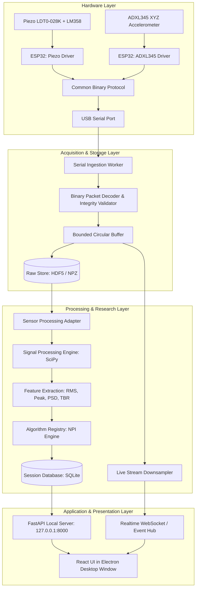

# Architecture Specification — NeuroPulse MVP

## Acquisition session persistence

The local acquisition start request carries the session ID, sensor type, processing profile, selected ADXL345 channel, participant pseudonym, and study ID. The backend validates the profile/sensor pairing, rejects reused session IDs, starts the reader, and creates the matching SQLite session and audit event. On stop, the reader is awaited before immutable raw files are written; the backend then runs the selected profile against that stored recording and updates the same session with provenance, timestamps, duration, sample count/rate, checksum, storage path, quality flags, TBR, and experimental NPI. A failed post-stop analysis is returned as a finalization error while preserving the raw recording for later reprocessing.

This flow has deterministic simulator integration coverage. Physical timing, sensor calibration, serial throughput, and long-run behavior remain hardware-in-the-loop gates.

## Local backup and restore

`scripts/neuropulse_backup.py` creates a SQLite-consistent snapshot plus the local `sessions/` files, with a SHA-256 manifest. Restore verifies every listed file in a temporary directory and refuses to overwrite an existing destination. Before exposing the restored database, it revokes all saved authentication sessions so an older backup cannot resurrect a browser token. Archives are unencrypted; the workstation/storage security policy must define encryption and retention before research deployment.

## Windows Desktop Shell

The desktop entry point is `desktop/main.cjs`. Electron serves the built React assets on the private `neuropulse://app` origin, opens a standalone application window with renderer isolation enabled, then starts FastAPI bound to `127.0.0.1`. API calls use the loopback URL and allow only the desktop origin (plus the existing local development origins). The shell does not open an external browser. The current developer-run shell expects the project Python environment and dependencies to be installed; bundling the Python runtime/backend and producing a self-contained installer are still open under D-024.

---

## 1. System Context & Overview

NeuroPulse is a research signal processing system that collects wrist micro-vibrations, validates and archives raw data, and executes experimental signal processing pipelines to analyze micro-tremor power distributions in the 3–6 Hz band.

---

## 2. Key Architecture Principles

1. **Local-First & Offline:**
   The desktop shell serves its bundled React UI on a private `neuropulse://app` origin. Its FastAPI service binds only to `127.0.0.1`; CORS accepts the desktop origin and local development origins. The complete system executes on the workstation without cloud subscriptions or commercial telemetry.
2. **Decoupled Concurrency:**
   The serial reading worker runs independently of API request threads and UI updates. Under high sampling rates (e.g. 1000 Hz), UI rendering pauses never block the serial ingestion pipeline.
3. **Dual Modality Abstraction:**
   Sensor A (Piezo 1-channel voltage counts) and Sensor B (ADXL345 3-channel acceleration) are treated as distinct physical modalities with dedicated firmware drivers, raw storage channels, and signal processing adapters.
4. **Reproducibility & Provenance:**
   Every processing run and algorithm execution records the raw file hash, software commit, profile version, and parameter snapshot. Data provenance is tracked as `simulated`, `device`, `imported_benchmark`, or `reprocessed`.
