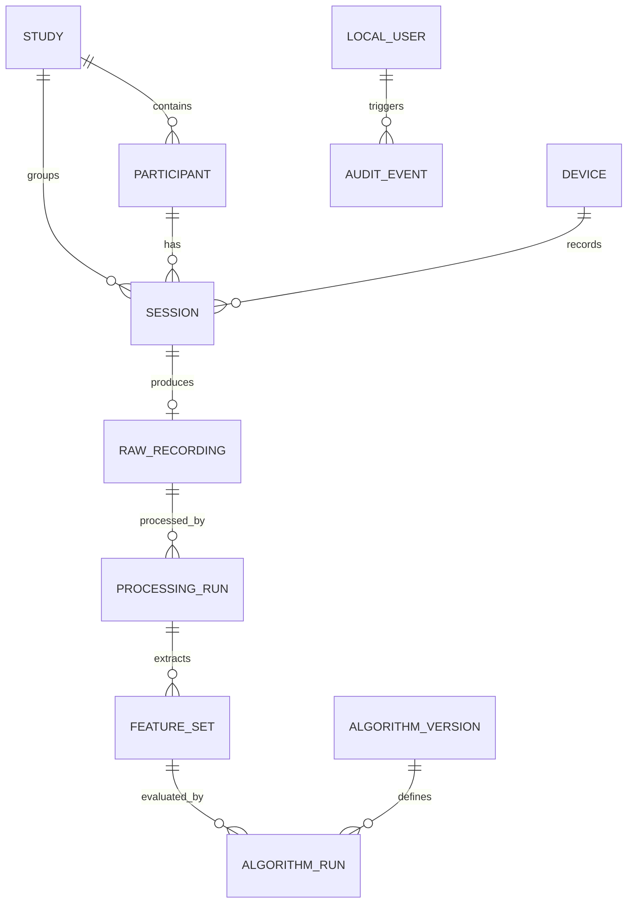

# Database Schema Specification — NeuroPulse MVP

---

## 1. Relational Entities (SQLite / SQLAlchemy)

The metadata database stores studies, pseudonymized participants, devices, sessions, processing runs, algorithm evaluations, and audit logs. Bulk time series data is stored in HDF5 files referenced by the session records.

---

## 2. Table Definitions

### Implementation status (checked 2026-10-21)

The entity list below describes the target research data model. It is **not** a
claim that every entity currently exists in the running database. The current
SQLAlchemy models in `backend/app/db/models.py` create these seven tables:

| Implemented table | Current persisted fields |
|---|---|
| `sessions` | `id`, `study_id`, `participant_code`, `sensor_type`, `profile_id`, `status`, `provenance`, `start_time`, `end_time`, `duration_sec`, `sample_count`, `sample_rate_hz`, `tbr`, `npi_value`, `npi_category`, `quality_status`, `quality_flags`, `dominant_freq_hz`, `sha256_hash`, `notes`, `raw_data_path`, `created_at`, `updated_at`, `is_deleted` |
| `devices` | `id`, `serial_port`, `baud_rate`, `sensor_type`, `firmware_version`, `protocol_version`, `is_simulator`, `last_connected`, `created_at` |
| `studies` | `id`, `name`, `protocol_version`, `description`, `sensor_type`, `target_duration_sec`, `tbr_min`, `tbr_max`, `created_at` |
| `patients` | `id`, `patient_code`, `full_name`, `date_of_birth`, `chromosome_marker`, `age_band`, `medical_history`, `family_history`, `diet`, `retain_indefinitely`, `retention_expires_at`, `created_at`, `updated_at` |
| `audit_events` | `id`, `timestamp`, `action`, `actor`, `session_id`, `detail` |
| `local_users` | `id`, `username`, `password_hash`, `role`, `is_active`, `created_at` |
| `auth_sessions` | `id`, `user_id`, `token_hash`, `expires_at`, `revoked_at`, `created_at` |

Raw sample arrays are stored in per-session HDF5/JSON files, not a normalized
`raw_recordings` table. Patient profiles are stored in `patients`; sessions associate
through `participant_code`. Separate `participants`, `processing_runs`, `feature_sets`,
`algorithm_versions`, and `algorithm_runs` tables from the target model are not
implemented; some processing results currently live on the session row. Consent
records and automatic expiry deletion are not implemented. Patient codes are generated
at profile creation using that year's two-digit code, which may differ from the actual
first measurement year if measurement is delayed; this remains an open workflow decision.
The app now applies Alembic migrations
at startup. Empty databases are created by that migration. An unversioned
database is adopted only when each existing table's columns, types, nullability,
and primary keys match the current baseline; missing baseline tables are then
created without replacing existing rows. An incompatible or unknown legacy
schema is refused with an error instead of being altered automatically. This
baseline does not transform earlier schemas with renamed or changed columns;
those installations need a reviewed follow-up migration. Downgrading the initial
revision is disabled because dropping its tables would destroy local metadata;
restore a verified backup for rollback.

1. **`local_users`**: `id`, `username`, `password_hash`, `role` (`admin`, `operator`, `researcher`, `reviewer`, `kiosk`), `is_active`, `created_at`. Password hashes use scrypt; plaintext passwords are never stored or returned.
2. **`auth_sessions`**: `id`, `user_id`, `token_hash`, `created_at`, `expires_at`, `revoked_at`. Raw bearer tokens are only returned at login/bootstrap; the database stores SHA-256 token digests and supports logout, expiry, and account deactivation.
3. **`studies`**: `id`, `study_code` (unique), `title`, `protocol_version`, `description`, `created_at`.
4. **`participants`**: `id`, `study_id`, `participant_code` (pseudonym, e.g. `P-001`), `consent_recorded` (bool), `consent_version`, `consent_timestamp`, `created_at`.
5. **`devices`**: `id`, `device_id` (unique), `board_type`, `sensor_type` (`PIEZO_LDT0_028K`, `ADXL345`), `firmware_version`, `serial_number`, `created_at`.
6. **`sessions`**: `id` (UUID), `study_id`, `participant_id`, `device_id`, `operator_id`, `provenance` (`simulated`, `device`, `imported_benchmark`), `sensor_type`, `status`, `started_at`, `ended_at`, `notes`.
7. **`raw_recordings`**: `id`, `session_id`, `file_path`, `file_sha256`, `total_samples`, `sample_rate_hz`, `channel_names` (JSON), `duration_seconds`, `integrity_status`.
8. **`processing_runs`**: `id`, `raw_recording_id`, `profile_id`, `profile_version`, `software_commit`, `status`, `created_at`.
9. **`feature_sets`**: `id`, `processing_run_id`, `window_index`, `window_start_sec`, `window_end_sec`, `rms`, `dominant_freq_hz`, `power_3_6hz`, `power_1_20hz`, `tbr`, `quality_flags` (JSON).
10. **`algorithm_versions`**: `id`, `algorithm_id`, `version`, `display_name`, `formula_type`, `default_parameters` (JSON), `status`.
11. **`algorithm_runs`**: `id`, `feature_set_id`, `algorithm_version_id`, `parameter_snapshot` (JSON), `npi_value`, `evaluated_at`. The prototype may persist/display the D-017 experimental demo category only with its threshold/rule version and experimental label; it is not a clinical classification.
12. **`audit_events`**: `id`, `actor_id`, `action`, `entity_type`, `entity_id`, `timestamp`, `details` (JSON).
# Timestamp handling

Metadata timestamps are sourced from an aware UTC clock. SQLite's current
`DateTime` columns store naive values, so the application normalizes them to
naive UTC at the persistence boundary. Code reading these columns must interpret
them as UTC, not workstation-local time. When writing an ISO timestamp outside
the database, include an explicit UTC offset. This preserves existing database
compatibility while avoiding local-time interpretation.
